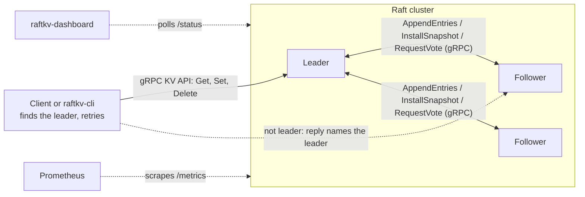
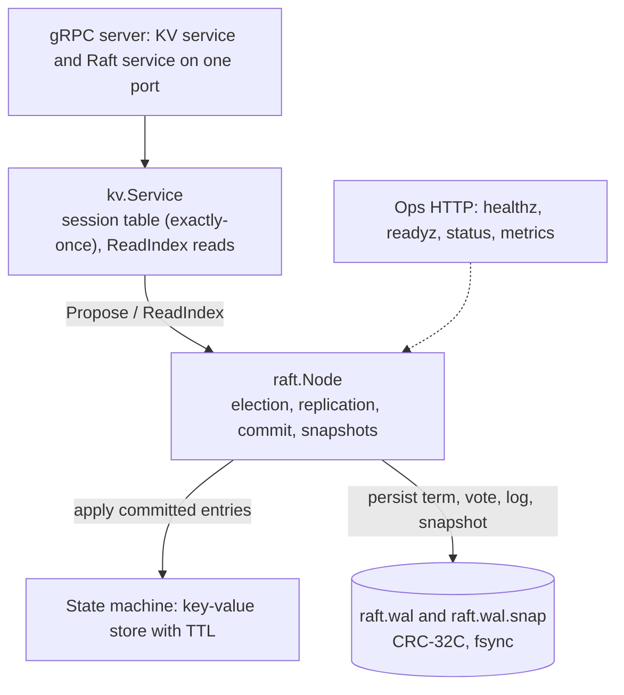

# raftkv

[](https://github.com/sqmi511/raftkv/actions/workflows/ci.yml)

A fault-tolerant, **linearizable key-value store** built on the **Raft** consensus algorithm, written in Go from scratch. Run it on 3 to 5 nodes: it elects a leader, replicates every write to a majority before acknowledging it, survives node crashes and network partitions without losing acknowledged data, and recovers from its own disk after a restart.

It is a learning and portfolio project, not a production database (see [Known limitations](#known-limitations)).


## Features

- **Raft consensus**: leader election with randomized timeouts, log replication, commit tracking, snapshots with log compaction, and `InstallSnapshot` for lagging followers.
- **Durable**: a checksummed write-ahead log (CRC-32C, fsync on every write, torn-write repair on startup) and atomically replaced snapshot files.
- **Linearizable reads** via ReadIndex (no stale reads from a deposed leader) and **exactly-once writes** via client IDs and request IDs, so retries are safe.
- **Key-value API over gRPC**: `Get`, `Set` (with optional TTL), `Delete`. Followers redirect clients to the leader.
- **Client library, CLI and benchmark tool** with automatic leader discovery, redirects and retries.
- **Operations**: flags or a YAML config file, `/healthz`, `/readyz`, `/status`, Prometheus `/metrics`, structured `slog` logging, Docker Compose, and a live web dashboard.
- **Chaos testing**: random node kills and restarts, network partitions, packet drops and delays against a 5-node cluster, with the recorded history checked by a **linearizability checker** written for this project.
- **Sharding** (client-side): consistent-hash routing across several independent Raft groups.
- **Dependencies**: only gRPC, protobuf and testify-style standard library tests. The Prometheus metrics, YAML reader and linearizability checker are small standard-library implementations.

## Quick start

You need Go (the version in `go.mod`). On Windows, `go test -race` additionally needs a C compiler such as MinGW-w64.

```powershell
go build -o bin\raftkv-server.exe ./cmd/server
go build -o bin\raftkv-cli.exe ./cmd/cli
```

### Three nodes on one machine

One node per terminal:

```powershell
.\bin\raftkv-server.exe -listen 127.0.0.1:7001 -peers 127.0.0.1:7002,127.0.0.1:7003 -http-addr 127.0.0.1:8001 -data-dir data\n1
.\bin\raftkv-server.exe -listen 127.0.0.1:7002 -peers 127.0.0.1:7001,127.0.0.1:7003 -http-addr 127.0.0.1:8002 -data-dir data\n2
.\bin\raftkv-server.exe -listen 127.0.0.1:7003 -peers 127.0.0.1:7001,127.0.0.1:7002 -http-addr 127.0.0.1:8003 -data-dir data\n3
```

Or run `scripts\local-cluster.ps1` to start all three plus the dashboard, or `scripts\demo.ps1 -Dashboard` for the full scripted demo (kills the leader, then the majority).

On Linux or macOS, the same commands work with `./bin/raftkv-server` and forward slashes.

### Docker

```bash
docker compose up --build -d          # 3 nodes + dashboard at http://127.0.0.1:9000
docker compose exec node1 raftkv-cli -addr node1:7000,node2:7000,node3:7000 set hello docker
docker compose stop node1             # kill a node (maybe the leader), then read again
docker compose down -v
```

### Using the cluster

```powershell
$a = "127.0.0.1:7001,127.0.0.1:7002,127.0.0.1:7003"
.\bin\raftkv-cli.exe -addr $a set name sami
.\bin\raftkv-cli.exe -addr $a set -ttl 30s session abc123
.\bin\raftkv-cli.exe -addr $a get name
.\bin\raftkv-cli.exe -addr $a del name
Invoke-RestMethod http://127.0.0.1:8001/status
```

From Go:

```go
import "github.com/sqmi511/raftkv/client"

cl, err := client.New(client.Options{Addrs: []string{"127.0.0.1:7001", "127.0.0.1:7002", "127.0.0.1:7003"}})
if err != nil { /* ... */ }
defer cl.Close()

ctx := context.Background()
_ = cl.Set(ctx, "greeting", []byte("hello"), 0)
value, found, err := cl.Get(ctx, "greeting")
```

Other languages can generate a client from [`api/proto/kv.proto`](api/proto/kv.proto).

### Good fits and bad fits

It suits sessions and tokens (TTLs), caches, configuration and feature flags, locks and small coordination data. It is **not** a SQL database: there are only exact-key `get`, `set` and `del`, no queries or joins.

## Architecture



Inside one node:



## How it works and why

- **Write path.** A write goes to the leader, is appended to its log and fsynced, replicated to followers, and acknowledged only after a majority has it **and** it is applied. A new leader first commits a no-op entry from its own term, so entries from earlier terms are committed safely (the Raft paper's Figure 8 case).
- **Linearizable reads.** A read records the leader's commit index and confirms leadership with heartbeat acknowledgements from a majority that were sent *after* the read arrived (ReadIndex). It then waits for the state machine to reach that index. A partitioned old leader can't gather the majority, so it blocks instead of returning stale data. Reads that arrive together share one heartbeat round.
- **Exactly-once writes.** Each client has a random ID and a request counter. Both travel inside the replicated command, and every replica keeps a session table as part of the state machine. A retry that reaches a new leader after a failover is recognised as a duplicate, and a retried `Delete` returns its original answer.
- **Crash safety.** Term, vote and log entries are fsynced before a node replies to an RPC. WAL records carry a CRC-32C over length and payload. A torn tail from a crash is truncated silently, while corruption in the middle of the log is reported rather than hidden. Snapshots are written to a temp file, fsynced and renamed, and a crash between writing a snapshot and compacting the log is handled on load.
- **Snapshots.** After a configurable number of applied entries, the state machine (live keys with absolute expiry times, plus the session table) is serialized and the log before it is dropped. A follower that needs entries the leader no longer has gets the snapshot via `InstallSnapshot`.
- **TTLs** are stored as absolute times chosen by the leader, so replaying a log after a restart never extends a key's life. Expired keys are invisible immediately and freed by a background sweeper.
- **One port per node** serves both the client API and node-to-node Raft RPCs. A node's ID is its advertised `host:port`, so a "not leader" reply carries an address the client can dial directly.
- **Storage failures stop the node.** After a failed write or fsync, a node takes itself out of service instead of acknowledging state it can't make durable.

## Benchmarks

Windows 11, 16 logical CPUs, Go 1.26, three separate `raftkv-server` processes on one machine (loopback network), WAL fsynced on every write, 128-byte values, 100 keys, 5 s per scenario, benchmark client on the same machine. Produced by `go run ./cmd/bench`.

| Workload | Clients | Ops/sec | p50 (ms) | p95 (ms) | p99 (ms) | max (ms) | Errors |
|---|---:|---:|---:|---:|---:|---:|---:|
| write, 1 client | 1 | 271 | 3.43 | 4.66 | 6.30 | 46.51 | 0 |
| write, 16 clients | 16 | 581 | 23.68 | 46.85 | 52.83 | 65.80 | 0 |
| read (linearizable), 16 clients | 16 | 14,816 | 1.10 | 2.18 | 2.96 | 12.29 | 0 |
| mixed 50/50, 16 clients | 16 | 1,177 | 11.55 | 25.33 | 30.81 | 38.61 | 0 |

**Failover** (in-process 3-node cluster, leader crashed, 10 trials, election timeout 300 to 600 ms, time counted from the crash):

| | New leader elected | First successful client write |
|---|---:|---:|
| median | 423 ms | 574 ms |
| worst of 10 | 1,050 ms | 1,232 ms |

How to read these:
- **Writes are bound by fsync.** Every proposal is fsynced individually and concurrent proposals are not batched, so 16 clients get only about 2x one client. Group commit is the obvious next optimization.
- **Reads are about 25x faster** because they need no disk write and share heartbeat rounds.
- **Failover is dominated by the election timeout.** The slowest trial was likely a split vote, which costs one extra election round.
- Numbers on a laptop with client and cluster sharing CPUs are a lower bound for what separate machines would do, and loopback hides real network latency.

## Testing

```powershell
go test -race -count=1 ./...                         # everything, including 5 chaos scenarios (~1 min)
go test -race -count=1 -v ./test/chaos "-chaos.duration=30s"   # longer chaos run
go test -race -count=1 -v -run TestChaosEverything ./test/chaos "-chaos.seed=12345"
go run ./cmd/bench                                   # benchmarks (run without -race)
```

- **Unit and integration tests** cover every package: store, WAL (including a cut at every byte offset of a torn write and a real process crash), Raft (election safety, log matching, commit rules, snapshots), the KV service, gRPC transport, config, metrics, ops endpoints and dashboard.
- **Chaos tests** run a 5-node cluster under four concurrent clients while injecting node kills and restarts, partitions, packet drops (including lost replies) and delays. Every operation is recorded with start and end times and the history is checked by `internal/lincheck`, a Wing-Gong linearizability checker with memoization. Operations whose outcome is unknown (timeouts) are modelled as "may take effect at any time after they start, or never". After healing, a final linearizable read of every key joins the history, and all replicas must converge to the same values.
- The checker has its own tests, including histories it must reject (stale reads, lost writes, impossible orders), so a passing chaos run means something.

## Project layout

```
cmd/server        raftkv-server: one cluster node
cmd/cli           raftkv-cli: command-line client
cmd/bench         raftkv-bench: throughput, latency and failover benchmarks
cmd/dashboard     raftkv-dashboard: live web view of the cluster
cmd/shardcli      raftkv-shardcli: client for several sharded clusters
client/           Go client library (leader discovery, retries, exactly-once writes)
api/proto/        protobuf definitions and generated code (kvpb: client API, raftpb: node-to-node)
internal/raft     consensus: election, replication, ReadIndex, snapshots, storage (+ raftest: in-memory test network)
internal/wal      checksummed write-ahead log
internal/store    in-memory key-value store with TTL
internal/kv       replicated state machine, sessions, service (+ kvtest: in-process test clusters)
internal/transport  gRPC servers and the Raft client transport
internal/shard    consistent-hash ring and sharded client
internal/lincheck linearizability checker
internal/bench    benchmark harness
internal/dashboard, ops, metrics, config   operations tooling
test/chaos        chaos tests
scripts/          local cluster and demo scripts
```

## Configuration

Flags, or `-config node.yaml` (flags override the file; see [`configs/node.example.yaml`](configs/node.example.yaml)). The main ones:

| Flag | Meaning |
|---|---|
| `-listen` | address to bind for clients and peers |
| `-advertise` | address others use to reach this node (also its node ID) |
| `-peers` | comma-separated advertise addresses of the other nodes (empty = single node) |
| `-data-dir` | where the log and snapshots live |
| `-http-addr` | health, status and metrics endpoint (empty disables it) |
| `-snapshot-threshold` | applied entries between snapshots |
| `-election-timeout-min/max`, `-heartbeat-interval` | Raft timing |
| `-log-level`, `-log-format` | `debug`..`error`, `text` or `json` |

Endpoints: `/healthz` (liveness), `/readyz` (a leader is known), `/status` (JSON), `/metrics` (Prometheus: gRPC request counts and latency histograms, plus Raft term, role, commit, applied and snapshot indexes).

## Sharding

One Raft group stores every key. `raftkv-shardcli` and `internal/shard` spread keys over several independent groups with a consistent-hash ring (256 virtual nodes per group), so adding a group only moves keys *to* it. Groups fail independently: the tests kill a group's majority and show that the other group keeps serving.

```powershell
raftkv-shardcli -groups "a=127.0.0.1:7101;b=127.0.0.1:7102" set key-1 hello
raftkv-shardcli -groups "a=127.0.0.1:7101;b=127.0.0.1:7102" where key-1
```

The group list is static and routing is client-side. Changing it does **not** migrate data.

## Known limitations

- **Security:** all traffic is plaintext and unauthenticated. Raft RPCs share the client port, so any client that can reach a node can call them. The dashboard and ops endpoints reveal topology. TLS/mTLS and a separate peer port are the next hardening steps.
- **Membership is static.** Every node's peer list is fixed at startup; nodes can't be added or removed at runtime.
- **Write throughput:** one fsync per proposal, no batching or pipelining.
- **No PreVote or CheckQuorum.** A partitioned node keeps raising its term and can force one extra election when it rejoins, and a partitioned leader keeps believing it leads (safely: its reads and writes block) until it hears a higher term.
- **Snapshots** are sent in one message (limit 64 MiB) and created while holding the node lock, so a large state briefly stalls RPC handling. Compaction rewrites the WAL via a rename, which an antivirus scanner on Windows can occasionally block (the node then stops rather than risk corruption).
- **Sessions** are capped at 10,000 clients; an evicted client loses exactly-once protection for a retry of its last request. Each client issues one write at a time.
- **TTLs** use the leader's wall clock, so clock skew between nodes shifts when keys appear to expire.
- **Chaos tests** inject faults in an in-process network and keep storage across "crashes", so they don't cover TCP-level faults or losing unsynced data. Seeds reproduce the fault schedule, not the exact interleaving.
- **Sharding:** static groups, client-side routing, no data migration, no cross-shard transactions.
- The YAML reader supports a flat subset only, and the metrics are hand-rolled and basic.

## License

See [LICENSE](LICENSE).